# Hermes Duplicate Settings

**by BeeWorks** — package `bw-duplicate-endpoints` · Hermes Desktop plugin · MIT · English UI

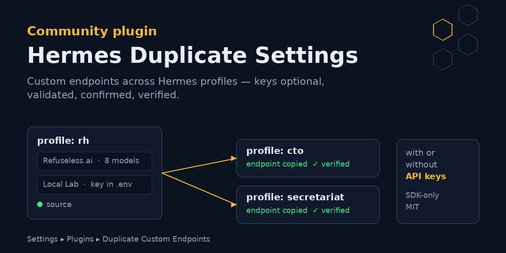

Hermes stores custom OpenAI-compatible endpoints **per profile**. Use the same
endpoint on three profiles and you re-enter it three times by hand. This plugin
fixes that with a guided, validated duplication workflow — and adds a compact
profile-management surface on top.

> **One endpoint, every profile.** Copy custom endpoints between Hermes profiles
> with or without their API keys. Every run is confirmed up front, validated,
> and verified by reading the target back.

---

## 📦 Install

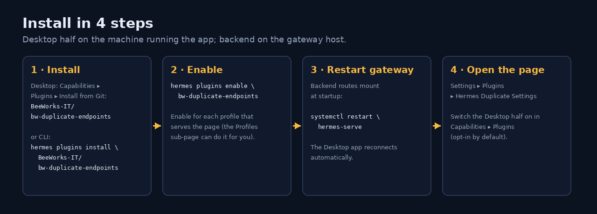

### Option A — Hermes Desktop (recommended)

1. Open **Capabilities ▸ Plugins ▸ Install from Git**.
2. Enter **`BeeWorks-IT/bw-duplicate-endpoints`** and install.
   - The **Desktop half** lands on the machine running the app.
   - The **agent/backend half** installs into the profile you select — pick the
     profile your Desktop connects to (repeat for other profiles, or use the
     plugin's *Profiles* page later).
3. **Restart the gateway once** so the backend routes mount
   (e.g. `systemctl restart hermes-serve` on the gateway host). The Desktop app
   reconnects on its own.
4. Open **Settings ▸ Plugins ▸ Duplicate Custom Endpoints** and switch the
   Desktop half on in **Capabilities ▸ Plugins** (it is opt-in by default).

### Option B — CLI

```bash
hermes plugins install BeeWorks-IT/bw-duplicate-endpoints --enable
# restart the gateway once (backend routes mount at startup):
systemctl restart hermes-serve        # or: hermes gateway restart
```

Enable it for **each profile** that should serve the page:

```bash
HERMES_HOME=~/.hermes/profiles/<name> hermes plugins enable bw-duplicate-endpoints
```

### Option C — local development (hot reload)

```bash
git clone https://github.com/BeeWorks-IT/bw-duplicate-endpoints
ln -s "$PWD/bw-duplicate-endpoints" ~/.hermes/plugins/bw-duplicate-endpoints
hermes plugins enable bw-duplicate-endpoints
```

A linked package hot-reloads the Desktop half on every save.

> **Remote backend?** The backend runs where the gateway runs; the Desktop half
> runs where the app runs. Install both sides (Option A does both in one
> dialog). **Catalog listing:** submitted for review in
> [NousResearch/hermes-agent#157872](https://github.com/NousResearch/hermes-agent/pull/157872) —
> once merged, `hermes plugins install bw-duplicate-endpoints` will work by name.

---

## What you get

**Settings ▸ Plugins ▸ Hermes Duplicate Settings** — five sub-pages, plus three
command-palette entries. English UI.

| Sub-page | What it does |
|---|---|
| **Duplicate endpoints** | The guided cross-profile duplication workflow (below). |
| **New endpoint** | Create one endpoint on several profiles at once from a single form. |
| **Profiles** | One card per profile: state, inventory, metadata, backend enablement, default route. |
| **Settings** | Duplication defaults, preferred source, auto-refresh, results retention, backend status. |
| **Help** | What the plugin does, key handling, safety, install commands. |

### Screenshots

The duplication page — source selection with filters and probes, targets,
options, and the gated validation step:

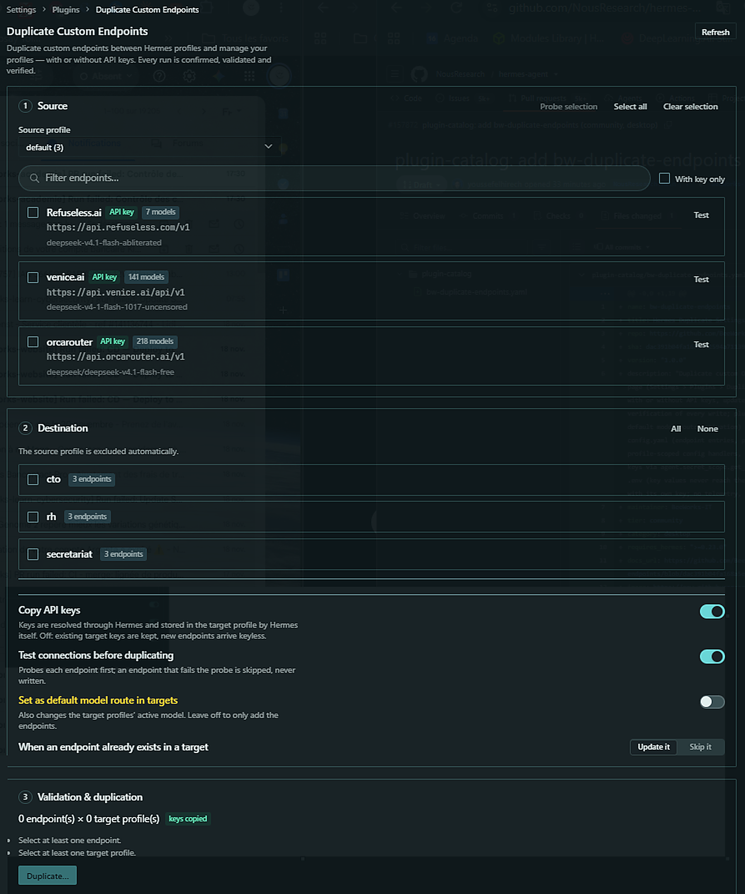

The Settings sub-page — duplication defaults and backend status:

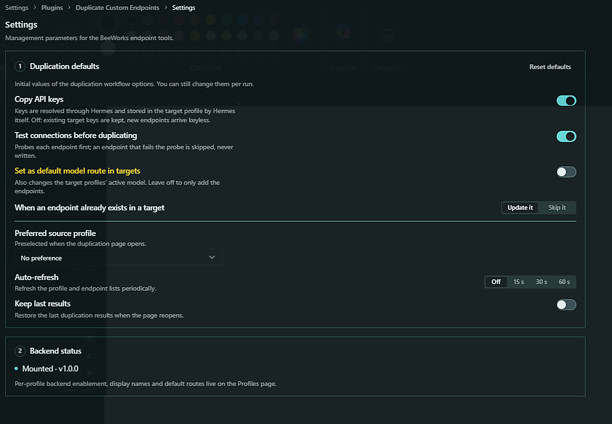

### Duplication workflow

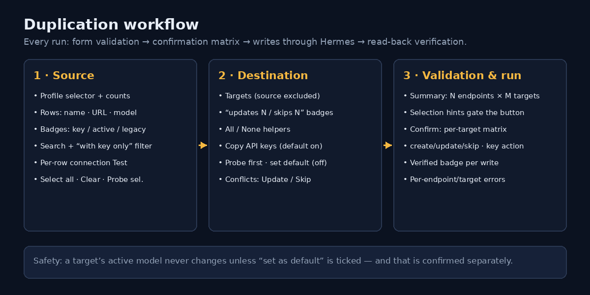

1. **Source** — pick a profile, see its endpoints (name, URL, default model,
   model count, key/active/legacy badges). Filter by text or "with key only",
   probe connections per row or for the whole selection.
2. **Destination** — tick target profiles (the source is excluded). Badges show
   how many selected endpoints already exist there ("updates N" / "skips N").
   Choose the options:
   - **Copy API keys** (default on) — through Hermes' credential store.
   - **Test connections before duplicating** (default off) — failed probes are
     skipped, never written.
   - **Set as default model route in targets** (default off) — changes the
     targets' active model; clearly flagged.
   - **Existing endpoints: Update / Skip**.
3. **Validation & duplication** — the button stays disabled until the selection
   is complete (with explicit hints). A confirmation dialog shows the exact
   per-target matrix (create/update/skip · copy/keep/no key). After the write,
   every result is **read back and verified**; errors are reported per
   endpoint and target.

### Multi-profile creation

The **New endpoint** sub-page creates one endpoint on several profiles at once:
name, provider id, base URL, default model, optional API key, transport,
context length, discovery/default-route flags — then a checkbox list of every
profile. Validation gates the button, a confirmation dialog lists the targets,
and each write is read back and verified. Keys are stored by Hermes in each
checked profile, never inline.

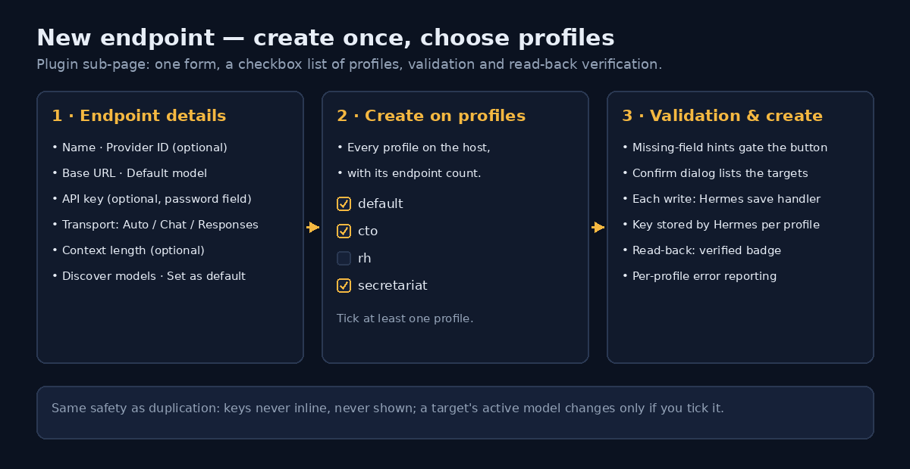

**Inside the core Custom Endpoints editor:** the plugin also ships a
forward-compatible contribution for the `customEndpoint.form` SDK area proposed
in the companion hermes-agent PR
([#157898](https://github.com/NousResearch/hermes-agent/pull/157898)). When a
Hermes release exposes that area, an **"Also create on other profiles"**
checkbox list appears directly in the core editor: tick profiles, press Save as
usual, and the endpoint is copied to the checked profiles automatically. On
older hosts the registration is skipped and the plugin's own pages cover the
workflow — nothing breaks.

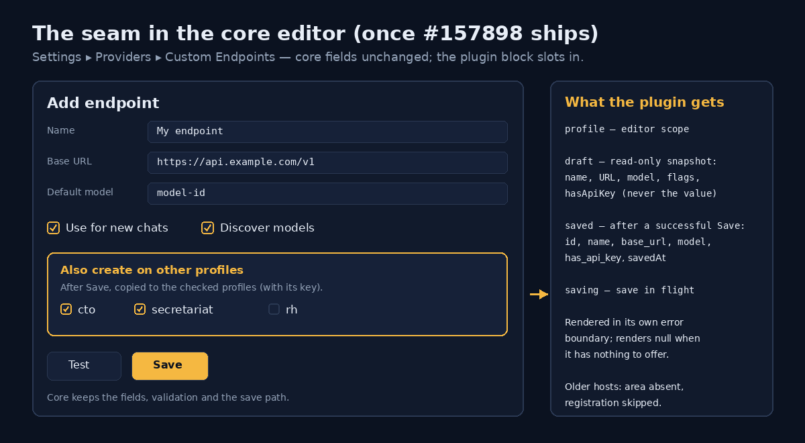

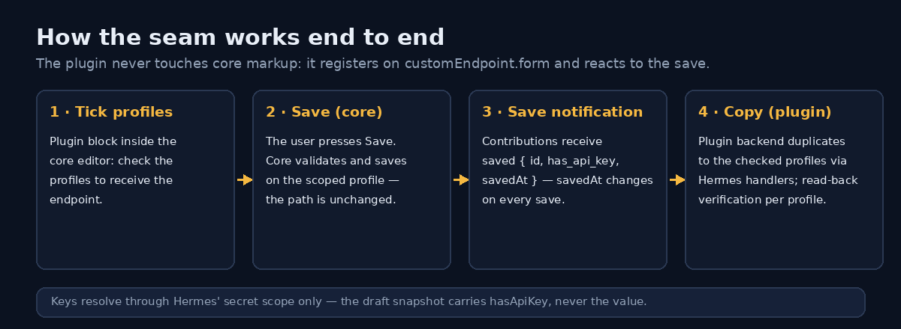

### Profile management

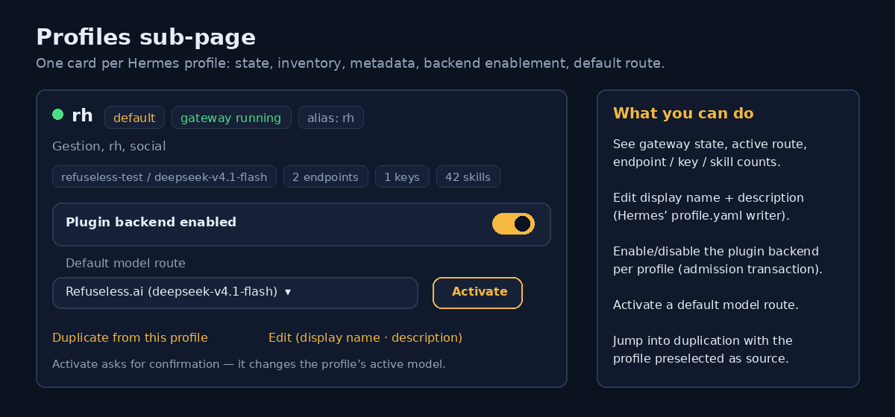

- Gateway state, active model route, endpoint/key/skill counts per profile.
- Edit **display name** and **description** (Hermes' canonical `profile.yaml`
  writer; editing confirms an auto-generated description).
- **Enable/disable the plugin backend per profile** — the same admission
  transaction as `hermes plugins enable`.
- **Activate a default model route** for a profile (confirmed dialog).
- **Duplicate from this profile** — jumps into the workflow with the source
  preselected.

Profile creation/deletion deliberately stays in Hermes' own profile tools.

### Settings & options

| Setting | Default | Effect |
|---|---|---|
| Copy API keys | on | Initial value of the key-copy option. |
| Test connections first | off | Initial value of the pre-flight probe. |
| Set as default in targets | off | Initial value of the activation option. |
| Existing endpoints | Update | Update or skip conflicts. |
| Preferred source profile | none | Preselected when the duplication page opens. |
| Auto-refresh | off | Refresh lists every 15/30/60 s. |
| Keep last results | off | Restore the last results when the page reopens. |

All options remain changeable per run; **Reset defaults** restores everything.

---

## How API keys are handled

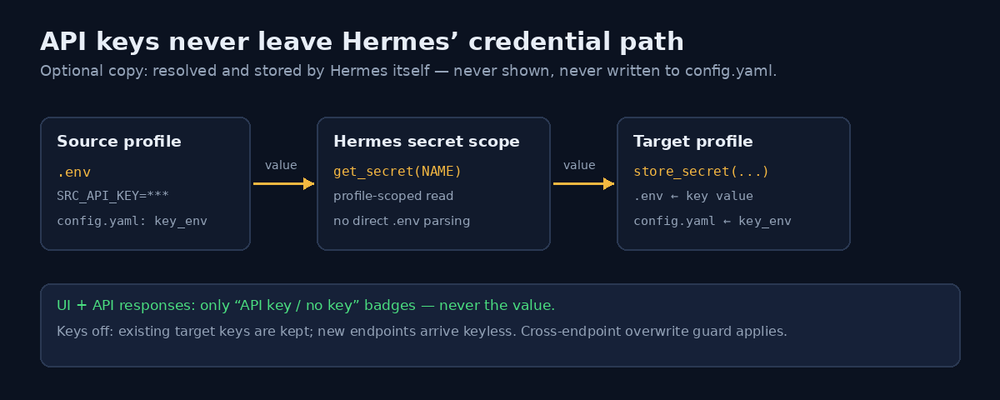

- Key values are resolved **only** through `agent.secret_scope.get_secret`
  under the source profile's scope, and stored by Hermes' own `store_secret`
  path into the target profile's `.env` (with the cross-endpoint overwrite
  guard).
- **No key value ever appears** in the UI, in `config.yaml`, or in any API
  response — the UI shows only "API key / no key" badges.
- With key copy **off**: an endpoint that already exists in a target keeps its
  own key; a new endpoint arrives keyless.

## Architecture

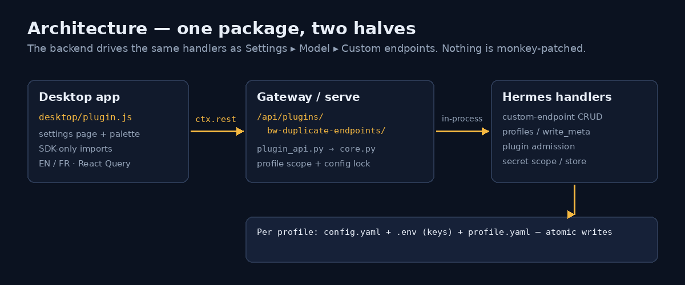

```
desktop/plugin.js  ──ctx.rest──▶  /api/plugins/bw-duplicate-endpoints/
                                   dashboard/plugin_api.py (FastAPI router)
                                   dashboard/bw_duplicate_endpoints_core.py
                                     └─▶ Hermes' own handlers:
                                         custom-endpoint CRUD · profiles ·
                                         plugin admission · secret scope
```

The backend **calls the same handlers the Settings panel uses**
(`list_custom_endpoints`, `upsert_custom_endpoint`, `activate_custom_endpoint`,
`validate_custom_endpoint`) under the profile scope and the config mutation
lock. Writes are atomic and comment-preserving; legacy `custom_providers` rows
are promoted exactly like the core edit path does. Nothing is monkey-patched.

**API routes:** `GET /health` · `GET /overview` · `GET /endpoints?profile=` ·
`POST /probe` · `POST /duplicate` · `GET /profiles` · `POST /profiles/meta` ·
`POST /profiles/plugin` · `POST /profiles/activate`.

## Safety & disclosure

- Reads/writes every profile's `config.yaml` (endpoints, plugin allow-lists,
  optionally the model route) and `profile.yaml` (metadata) — always through
  Hermes' own APIs.
- Optional probe: network calls go **only to your endpoints' own `base_url`**,
  with their own keys (same probe as the Settings Test button).
- No telemetry, no background processes, no self-updater, no agent tools/hooks.
- Desktop half: SDK-only imports (`@hermes/plugin-sdk`, `react`), no core
  markup access, no `eval`.
- Internal imports are disclosed in the source and in the catalog PR; the
  admission scanner verdict at the pinned commit is **safe**.

## Development

Structure follows the official packages in
[`NousResearch/hermes-official-plugins`](https://github.com/NousResearch/hermes-official-plugins):

```
bw-duplicate-endpoints/
├── plugin.yaml                  # agent manifest (no tools, no hooks)
├── __init__.py                  # no-op register() loader surface
├── dashboard/
│   ├── manifest.json            # backend mount declaration
│   ├── plugin_api.py            # FastAPI router
│   └── bw_duplicate_endpoints_core.py
├── desktop/plugin.js            # plain ESM, jsx() calls, SDK-only imports
├── tests/                       # pytest + node:test (production plugin vs SDK shim)
├── docs/                        # banner + explanatory images (generated)
└── scripts/                     # image generators, local install helper
```

```bash
# Python suite — Hermes runtime interpreter; TMPDIR must be OUTSIDE ~/.hermes
# so the throwaway HERMES_HOME resolves as its own root.
python -m venv --system-site-packages .venv && .venv/bin/pip install pytest
TMPDIR=/tmp .venv/bin/python -m pytest -q          # 28 tests

# Desktop suite — bundles the real plugin.js against a test-only SDK shim
npm install && npm run check && npm test           # 7 tests

# Catalog admission gate
hermes plugins validate .

# Regenerate the documentation images
python scripts/make_banner.py && python scripts/make_docs_images.py && python scripts/make_core_images.py
```

## Compatibility

Hermes `>=0.23.0` with the Desktop app. Works with local and remote gateways
(see the install note above).

## License

MIT — see [LICENSE](LICENSE).
